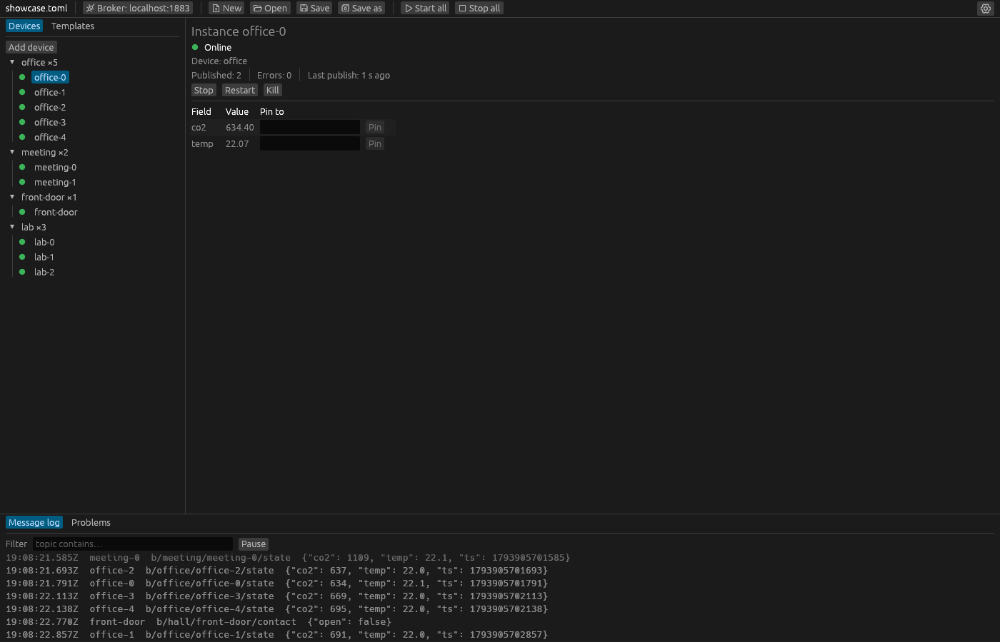

# Senzor

<a href="https://sonarcloud.io/summary/new_code?id=kankaj_Senzor"><picture>
  <source media="(prefers-color-scheme: dark)" srcset="https://sonarcloud.io/images/project_badges/sonarcloud-dark.svg">
  
</picture></a>

[](https://sonarcloud.io/summary/new_code?id=kankaj_Senzor)
[](https://sonarcloud.io/summary/new_code?id=kankaj_Senzor)
[](https://sonarcloud.io/summary/new_code?id=kankaj_Senzor)
[](https://sonarcloud.io/summary/new_code?id=kankaj_Senzor)

Simulated MQTT sensors, for testing whatever reads them: a dashboard, a backend that stores
readings, a home automation setup.

You describe a kind of sensor once, as a template, and Senzor runs as many copies of it as you ask
for. Each copy connects to your broker on its own, publishes values at a fixed interval and, if
you want, announces when it goes online and offline and leaves a Last Will for the broker to
publish if it drops off.



- **`senzor`**, a desktop window: edit a project, start and stop devices, pin a value such as
  CO2 = 2500 ppm, and watch every message.
- **`senzor-cli`**, a headless runner for terminals, Docker and CI, reading the same project file.
- **AI agents** such as Claude Code can drive either of them over MCP.

Senzor speaks MQTT 5 by default and MQTT 3.1.1 when a project asks for it, with username and
password, TLS and client certificates. It does not include a broker; it connects to yours, for
example Mosquitto.

## Documentation

**[senzor.kankaj.cz/docs](https://senzor.kankaj.cz/docs)**: the
[quick start](https://senzor.kankaj.cz/docs/quick-start), the GUI guide, the project file
reference, running headless, recipes, and how to connect an AI agent.

## Installation

The window and the headless runner are packages of their own; install either or both.

```bash
# macOS, with Homebrew
brew install --cask kankaj/tap/senzor
brew install kankaj/tap/senzor-cli
```

On Windows the window is in the Microsoft Store:

<a href="https://get.microsoft.com/installer/download/9pc0635wjf44?referrer=appbadge" target="_self" >
    
</a>

On Linux, download the archive for your architecture from the
[latest release](https://github.com/kankaj/Senzor/releases/latest), unpack it and put the program on
your `PATH`:

```bash
# the window
tar -xJf senzor-x86_64-unknown-linux-gnu.tar.xz
install -Dm755 senzor-x86_64-unknown-linux-gnu/senzor ~/.local/bin/senzor

# the headless runner
tar -xJf senzor-cli-x86_64-unknown-linux-gnu.tar.xz
install -Dm755 senzor-cli-x86_64-unknown-linux-gnu/senzor-cli ~/.local/bin/senzor-cli
```

For Docker and CI, the headless runner is also a container image, for Linux on x86_64 and ARM.
Mount the folder with your project at `/work`:

```bash
docker run --rm -v "$PWD:/work" ghcr.io/kankaj/senzor-cli:1 run project.toml
```

With Rust installed, Cargo builds both from crates.io:

```bash
cargo install senzor-cli senzor
```

We are working on publishing Flatpak packages and adding packages to the
AUR as soon as it accepts new maintainers again. Every platform, Linux, macOS and Windows on x86_64
and ARM, has downloads in the [latest release](https://github.com/kankaj/Senzor/releases/latest).
[Installation](https://senzor.kankaj.cz/docs/installation) in the documentation has them all,
with the first start on macOS and Windows (the builds are not signed yet), required libraries for
Linux, updating, checking a download and building from source.

## A first run

Start a broker, then run the quick-start project, two CO2 sensors and a thermometer:

```bash
docker run -d --name mosquitto -p 127.0.0.1:1883:1883 eclipse-mosquitto:2 mosquitto -c /mosquitto-no-auth.conf
senzor examples/quick-start.toml          # in the window
senzor-cli run examples/quick-start.toml  # or headless
```

`examples/` holds more projects, such as IKEA sensors as Zigbee2MQTT publishes them and a fleet of
200 sensors. The window also offers them on its welcome screen.

## Changes

[CHANGELOG.md](CHANGELOG.md) lists what each version brings.

## Working on Senzor

The workspace has the window (`crates/senzor`), the CLI (`crates/senzor-cli`), the shared engine
and project model (`crates/senzor-core`), the MCP server (`crates/senzor-mcp`) and test helpers
(`crates/senzor-testkit`); the documentation site is in `website/`. [`dev/README.md`](dev/README.md)
covers the local Mosquitto brokers for tests and driving the window on a virtual display.

```bash
cargo test --workspace
cargo clippy --workspace --all-targets -- -D warnings
```

## Licence

Senzor is open source under the [Apache License 2.0](LICENSE). When you share Senzor or a program
that contains its code, include the licence and the [NOTICE](NOTICE) file, which credits the
Senzor project and its author, Jaroslav Kaňka.
